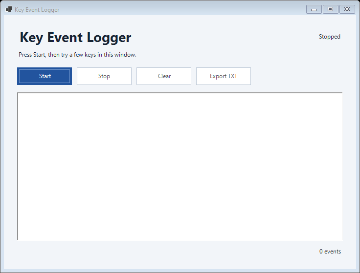
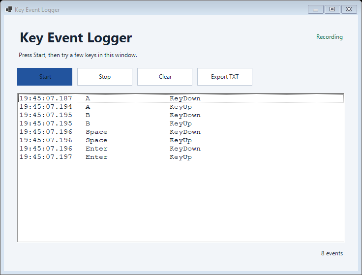

# Key Event Logger

A C# and Windows Forms application for inspecting keyboard events. It shows key names and local timestamps while its window is active and recording is enabled.

## Technologies

- C# and .NET 10
- Windows Forms, including `KeyDown` and `KeyUp`
- Standard .NET file APIs for TXT export

## Build and run

Requires Windows and the .NET 10 SDK. From the repository root, run:

```powershell
dotnet build KeyEventLogger.slnx
dotnet run --project KeyEventLogger/KeyEventLogger.csproj
```

## Use the logger

1. Select **Start** and press a few keys in the application window. The list shows the local time, key name, and event type.
2. Select **Stop** to stop recording. If you switch windows while recording, **Waiting for focus** appears and recording resumes when you return.
3. Select **Clear** to empty the list or **Export TXT** to choose a local file. The exported log contains a header and tab-separated timestamps, key names, and event types.

## Design and limitations

`MainForm` handles the UI and receives keyboard events. `KeyEvent` represents a single event. `TextLogExporter` writes the entries to disk only when the user exports them.

The app observes only events delivered to its active form. Windows and control navigation shortcuts may be handled before they reach the form. The app records key names rather than composing typed text. Entries stay in memory until cleared or the application is closed, unless you export them.

## Screenshots

**Before recording**



**Recording example**


